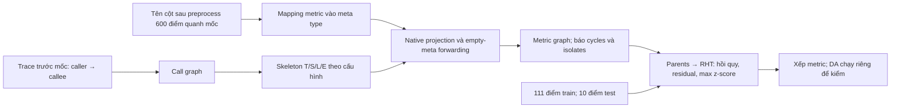

# Hồ sơ CIRCA — đồ thị kiến trúc

Phạm vi: structural graph (đồ thị cấu trúc) của CIRCA, dựng nguồn service call từ trace trước mốc trên RCAEval; RHT là scorer tham chiếu chung của T-014. Revision/hash ở `paper/source-manifest.json`. `CIRCA:` là đường dẫn trong `D:/RCA-ext/work/T-014/CIRCA/`; `RE:` là trong `D:/RCA-ext/src/RCAEval/`. Các phép kiểm dưới dẫn trực tiếp file kết quả. Hồ sơ phục vụ P1/G1; cấu hình P3 còn OPEN.

## 1. Bài toán và đầu vào

Mục tiêu là xếp hạng metric theo mức lệch khỏi hành vi bình thường có điều kiện trên các cha cấu trúc. Nguồn quan hệ gọi và luật cạnh không học từ tương quan metric của incident; candidate preprocessing trong phép tái lập vẫn có thể dùng dữ liệu sau mốc. Nó dùng service call graph và luật ánh xạ metric vào bốn meta metrics (nhóm ý nghĩa): Traffic (lưu lượng), Saturation (mức dùng tài nguyên), Latency (độ trễ), Errors (lỗi).

Đầu vào gồm bảng metric theo thời gian, mốc phát hiện bên ngoài, service identity và graph caller→callee. Trong adapter T-014, trace cung cấp graph trước mốc; trace không trực tiếp thành anomaly feature. Mỗi metric phải có ý nghĩa đo và service sở hữu. Cấu hình CIRCA gốc nhận tên component, dependencies và mappings từ YAML (`CIRCA:circa/graph/structural.py:39–59,92–119`). Nó không cần root label để fit hoặc dựng graph.

Graph service thiếu một cạnh có thể do trace mất span, không đủ tải ở reference, thành phần không được instrument hoặc quan hệ không xảy ra trong cửa sổ; không tự kết luận hai service độc lập. Service có metric nhưng không trace vẫn phải được báo trong coverage. Thống kê edge/isolates của từng ca phải lấy từ graph report.

## 2. Từng bước xử lý và công thức

**Bước 1 — đồ thị gọi bình thường.** Quy tắc của T-014: nối parent→child span theo `(traceID,spanID)`, lấy service parent làm caller và service child làm callee, chỉ giữ span hai đầu có startTime trước mốc. Bỏ self-call ở service graph và ghi parent không resolve được. Quy tắc này dùng boundary biết trước của phép tái lập; khi tự phát hiện phải dùng boundary detector/normal reference đã xác định. Không nối bằng spanID toàn cục và không lấy service root trong nhãn.

**Bước 2 — skeleton meta metrics.** Với mỗi service a, tạo `(a,T),(a,S),(a,L),(a,E)`. Các cạnh nội service trong cấu hình gốc là:

\[
T_a\to S_a,\quad T_a\to L_a,\quad T_a\to E_a,\quad S_a\to L_a,\quad S_a\to E_a,\quad L_a\to E_a.
\]

Với call a→b, đặt:

\[
T_a\to T_b,\qquad L_b\to L_a,\qquad E_b\to E_a.
\]

Ngoài ra, E_b→E_a với mọi a là caller ancestor của b trong call graph, không chỉ one-hop. `parents` và `children` trong YAML có comment dễ đọc nhầm; nghĩa thực thi lấy từ predecessor loop ở code (`CIRCA:tests/alg/sgraph/index.yml:7–33`; `structural.py:199–231`). Latency đi ngược hướng gọi vì thời gian xử lý callee đóng góp vào caller. Traffic cùng hướng gọi vì request tới caller tạo request tới callee. Đây là giả định cấu trúc, không phải quan hệ đã được ước lượng từ dữ liệu.

**Bước 3 — ánh xạ schema.** Quy tắc T-014 lấy suffix: workload→T; cpu/mem/socket/diskio→S; latency-50/latency-90 và suffix latency xác định→L; error→E. Mọi cột còn lại phải nằm trong bảng unknown; không dùng fault type để đoán. Gán cpu/mem của service vào S là quy tắc cho schema service này; nó khác ví dụ bài gốc có một component bộ nhớ riêng và phân loại usage là Traffic của component đó. Không được suy cùng tên metric luôn thuộc cùng meta type ở mọi hệ.

**Bước 4 — plug monitoring metrics vào skeleton.** Ký hiệu `M(v)` là tập metric gắn trực tiếp với meta node v; `V(v)` là tập metric nhìn thấy sau xử lý v. Với mapping mỗi metric vào một meta node, duyệt từ nguồn tới đích:

\[
Q(v)=\bigcup_{u\in Pa_{skel}(v)} V(u),\qquad
E_{metric}\gets E_{metric}\cup\bigl(Q(v)\times M(v)\bigr),\qquad
V(v)=\begin{cases}M(v),&M(v)\ne\varnothing\\Q(v),&M(v)=\varnothing.\end{cases}
\]

Đây là empty-meta forwarding (chuyển tiếp qua nhóm không có metric), hiện thực ở `CIRCA:structural.py:295–303`. Vì sao cần nó: khi không đo T/E của một service, cha quan sát được vẫn có thể liên hệ với con phía sau. Chỉ nối Cartesian product tại cặp meta types đã có metric sẽ bỏ những cạnh code gốc tạo.

Code còn hỗ trợ một monitoring metric thuộc nhiều meta nodes: đếm số lần gắn; bỏ lần trước để tránh self-loop; ở lần cuối lấy metric đó làm common effect của những meta nodes đã đi qua (`structural.py:263–293`). T-014 mapping một suffix→một type không cần nhánh này; muốn adapter cho dataset khác dùng multi-mapping phải kiểm thêm.

`StructuralGraph.visit` chỉ thêm cạnh, không add toàn bộ node mapping (`structural.py:259,300,305`). Vì vậy metric cô lập có thể không nằm trong graph trả về. Builder T-014 phải ghi rõ phần giữ isolated metric của adapter khác output graph gốc ở đâu và phải so equivalence edge/coverage, không bỏ node im lặng.

**Bước 5 — kiểm cấu trúc.** Kiểm cả call graph, skeleton và metric graph có DAG hay SCC. Upstream `topological_sort` vẫn chạy bằng condensation SCC; đó là xử lý lập trình, không làm graph cyclic thành causal DAG (`CIRCA:circa/utils.py:208–230`). Trong một SCC, vòng duyệt set không có thứ tự nhân quả. Khi thiếu meta node forwarding, cạnh/output có thể phụ thuộc thứ tự đó: cần phép kiểm thực thi, không đoán rằng code không lỗi nghĩa là lý thuyết hợp lệ.

**Bước 6 — RHT theo graph metric.** Với P_i là metric parents có dữ liệu và N/Q là train/test, fit:

\[
(\widehat b_i,\widehat\beta_i)=\arg\min_{b,\beta}\sum_{t\in N}\left[x_i(t)-b-\beta^\top x_{P_i}(t)\right]^2,
\quad e_i(t)=x_i(t)-\widehat b_i-\widehat\beta_i^\top x_{P_i}(t),
\quad s_i=\max_{t\in Q}\left|\frac{e_i(t)-\mu_{e_i}}{\mathrm{scale}_{e_i}}\right|.
\]

μ/scale fit trên residual train theo StandardScaler. Node không cha dùng z-score trực tiếp. Nhánh ValueError cũng chuyển sang z-score và phải ghi warning (`CIRCA:circa/alg/ci/anm.py:17–31`; `ci/base.py:44–52`; `alg/common.py:46–59`; `ci/__init__.py:78–101`). T-014 dùng cửa sổ RHT theo RCAEval để giữ scorer cố định; không gọi đó là default1min của code gốc.

**Bước 7 — DA khi kiểm.** Với θ=3 và score gốc, thu các child scores, thêm descendant evidence xuyên child có s<θ. Nếu s_i≥θ, cộng maximum thu được:

\[
D_i=\{s_j:j\in Ch(i)\}\cup\bigcup_{j\in Ch(i):s_j<\theta}D_j,
\qquad s'_i=s_i+\mathbf1[s_i\ge\theta]\max(D_i\cup\{0\}).
\]

Code gom child scores trước khi chỉnh, không dùng score child đã cộng DA để cộng tiếp. Key cuối là `(s'_i,−generation_i,s_i)`; nếu toàn key hòa vẫn phụ thuộc order. Node dưới ngưỡng vẫn được giữ trong output code (`CIRCA:ci/__init__.py:126–160`). Chỉ interpretation trên DAG phù hợp lý do ưu tiên ancestor. DA trên cyclic graph chỉ là kiểm code semantics.

Code chính thức đã kiểm bằng hashseed0–5: fixture DAG giữ một score vector, fixture cycle có hai (`audit/da-cycle.json`). Trong cycle a→b, b↔c với scores4,1,4, DA score c có thể bằng8 hoặc5. Đây là phụ thuộc thứ tự ở điểm số, không chỉ tie. Trên ca kiến trúc minh họa, graph là DAG nên không dùng lỗi fixture SCC để phủ định phép tính của ca đó. Nếu trace của ca khác tạo cycle, phải báo riêng trước diễn giải DA.

## 3. Đồ thị dùng ở đâu, theo K1 §3

| Vai trò | Biến thể kiến trúc |
|---|---|
| FEATURE_CONTEXT | Skeleton/mapping/call relations tạo parent set cho regression, trực tiếp đổi residual anomaly score. |
| CAUSAL_REASONING | Các cạnh giả định hướng ảnh hưởng; conditional deviation tìm metric tự lệch sau khi đã tính ảnh hưởng cha. |
| ROOT_CAUSE_RANKING | RHT xếp metric; DA tùy cấu hình truyền child evidence về ancestor. |

Trace ở đây dùng dựng cấu trúc reference, không trực tiếp phát hiện trace bất thường. Nó không phải PageRank và không tự đưa vùng ảnh hưởng đã có nhãn kiểm chứng. Metric rank khác service rank; service dedup là adapter đánh giá.

## 4. Tham số mặc định, kèm file:dòng

| Thành phần | Default/code gốc | Cấu hình tham chiếu T-014 |
|---|---|---|
| Loại/meta edges | T/S/L/E, như công thức trên; `tests/alg/sgraph/index.yml:1–33` | giữ các luật này |
| Mapping metric | người dùng khai báo, không có luật tự nhận mọi schema; `structural.py:56–87` | rule theo suffix RCAEval, unknown báo riêng |
| Interval | 1min; `circa/model/case.py:27` | 1s theo RE:rht.py:362 |
| Lookup/detect window | 120/10; `case.py:28–29`; train111 | giữ, nên thành111/10 điểm ở interval1s |
| Delay | 300s; `circa/alg/common.py:308` | t_d+300s |
| Prune | True; `case.py:30,102–108` | giữ và báo candidate coverage |
| Linear regressor class | LinearRegression(); `ci/anm.py:19` | giữ để khớp scorer RCAEval |
| RHT tau/use_confidence | 0/False; `ci/__init__.py:29–31` | giữ |
| RHT aggregator/workers/seed | max/1/0; `circa/alg/base.py:106–108` | một heavy process theo giới hạn task |
| RHT+DA production getter | threshold3; `models.py:629–634` | DA chỉ kiểm/giải thích, không chọn theo score |
| Empirical regression paper | SVR(sigmoid); `models.py:585` | chưa tự chuyển scorer chính sang SVR |

Một lựa chọn kiến trúc quan trọng chưa có WHY gồm mapping suffix, boundary trace và scorer chung. Các nơi dùng phải đánh dấu **(chờ WHY, xem de-xuat-tai-lieu-chung.md)**. Cửa sổ P3 chưa chốt.

Với default gốc 1min và current=t_d+5min, 10 điểm test ở t_d−4min…t_d+5min; một phần test còn trước sự cố. RCAEval1s/current=t_d+300s lấy test t_d+291s…t_d+300s. Vì vậy giữ cùng lookup/detect integers không phải giữ cùng ý nghĩa thời gian của bài. 111 điểm train cũng là điểm sau resample, không phải ngưỡng tối thiểu 111 quan sát thô độc lập.

## 5. Chỗ code khác bài

Đồ thị có cùng phương thức skeleton nhưng nguồn service graph của T-014 là trace normal, còn code nhận documentation/YAML. Mapping metric của RCAEval là quy tắc riêng của T-014; nó không tự có sẵn trong CIRCA.

T-014 giữ LinearRegression + RHT và cửa sổ1s theo RCAEval để đối chiếu cấu hình với PC. Đây là lý do so sánh; prior work và cơ chế của bản kiến trúc đầy đủ dùng SVR(sigmoid)+RHT+DA. Phương án mỗi nguồn dùng cấu hình sát prior riêng được xét trong nháp WHY; chưa chốt P3. Hai nhánh còn khác candidate coverage, parent sets và chiều cạnh nên không cô lập tác động nguồn đồ thị. RHT+DA tuyến tính kiến trúc đã được tính lại; bản empirical SVR+RHT+DA đầy đủ chưa kiểm. Lý do DA không hợp PC cyclic không bác DA trên metric graph kiến trúc đã cố định là DAG; nhưng output DAG không tự chứng minh cấu trúc đầu vào đúng giả định tác giả. Nguồn: `paper/cong-bo-circa.csv`, `graphs/aggregate.json`, `runs/regression-route-summary.json`, `yeu-cau-dau-vao.csv`. **(chờ WHY, xem de-xuat-tai-lieu-chung.md)**.

Paper §4.3 gọi s<3 là không thuộc root-cause indicators; đó là abnormal-candidate concept. Algorithm2 không ghi bước filter/delete/ranking rõ; code DAScorer giữ mọi scored node và Model xếp tất cả. θ3 trong cấu hình RHT+DA quyết nhận child score và truyền evidence, không cung cấp incident detector hay lọc danh sách output. RHT-only không có cutoff3. Đề xuất sửa câu K1 hiện dễ nhập hai cách hiểu ở `paper/dinh-chinh-k1-threshold.md`.

Algorithm 1 của bài có bước tích lũy Errors ở dòng17. `StructuralGraph.visit:295–303` không có branch riêng này; cấu hình `descendents[E]=E` tạo cạnh liên hệ E với caller ancestors. Không khẳng định hai cách tương đương cho mọi graph/mapping khi chưa kiểm. Metric cô lập bị code gốc bỏ do không add_nodes; nếu adapter giữ metric đó, phải ghi đây là sửa coverage và đối chiếu score/rank riêng.

README:9 cho biết artifact kết quả thuộc revision khác; số Table 3/4 phải lấy từ `paper/cong-bo-circa.csv`, không coi checkout T-014 tự reproduce chúng. Bản task không dùng dữ liệu Oracle chưa được phép để tìm cấu hình có điểm giống bài.

## 6. Giả định và điều kiện thất bại

Tác giả đặt ba giả định: graph là DAG; ngoại sinh giữa các node độc lập (Markovian); mọi can thiệp làm conditional distribution thay đổi quan sát được (Faithfulness). RHT còn giả định residuals theo normal độc lập và đồng phân phối (i.i.d.), dùng regression làm proxy cho structural equation. H0 là metric còn theo conditional distribution bình thường với parent values hiện tại. Đồ thị architecture có prior hướng hợp lý vẫn không tự bảo đảm proxy này đúng. [Bài CIRCA §2.1/4.2](https://netman.aiops.org/wp-content/uploads/2022/08/KDD22-CIRCA.pdf).

Giới hạn do tác giả nêu: normal reference chưa phủ các parent values sau fault tạo regression bias; meta metrics chưa có monitoring có thể trở thành hidden common causes, làm sai Markovian; DA cần xác minh trên thêm dữ liệu thật (§5.3.4/7). Tác giả đề xuất thu thêm dữ liệu và mô hình hóa các meta metrics ẩn trong công việc sau. Không có kết luận rằng empty-meta forwarding trong implementation đã chữa hoàn toàn hidden confounding.

Từ code/adapter có các điều kiện cần kiểm: call graph cyclic; missing trace tạo thiếu quan hệ; metric không map; service không có signal T/L/E cần forwarding; constant/near-constant residual; normal reference quá ngắn; timestamp hoặc service naming không khớp; graph không chứa candidate root. Không gọi auth không trace là evidence cho/chống graph: đó có thể là instrumentation gap hoặc đường gọi không xảy ra trong reference. Parent set thiếu, model sai và sampling sai là giải thích thay thế cho conditional score sai.

## 7. Ví dụ tính tay

Ca `re2tt_ts-order-service_loss_3` được chọn trước điểm: số cột processed nhỏ nhất trong 30 ca dev, hòa theo tên ca. Metric minh họa là top1 trong ranking RHT đã lưu. Ví dụ đầy đủ nằm ở `paper/vi-du-kien-truc.md`; số gốc ở `paper/vi-du-kien-truc.json`, snapshot và independent comparison.

Metric `ts-order-service_latency` có sáu parents: station_latency, order_workload và bốn Saturation metrics của order. Call order→station tạo station.L→order.L; quan hệ nội service đưa Traffic/Saturation vào Latency. OLS có rank bằng 6, intercept −0.14949284581942529. Residual train có mean 6.3575271173636493e−17, variance 4.0157130977163111e−08, scale 0.0002003924424152845. Không dùng nhánh ValueError hay scale bằng 1.

Tại t_d+296s, latency bằng 0.4; regression dự đoán 0.023147123945248205. Residual bằng 0.37685287605475171, nên |z|=1880.5742946821233. Đây là maximum của mười test scores. Independent OLS/RHT/DA so 272 nodes, 2176 thành phần PASS, max absolute error 3.3306690738754696e−16. Kiểm raw→preprocessing→resample/parents so 1088 mảng PASS với error bằng 0. Nguồn: `paper/compare-example-architecture/comparison.json`, `paper/window-example-architecture-002/window-comparison.json`.

DA cộng child inside-payment_latency có score 1.7265 vào latency này, thành 1882.3007946821233. Order_mem có RHT 4.914562285743208, thu bằng chứng order_latency 1880.5742946821233 và thành 1885.4888569678665. Vì vậy metric đứng đầu đổi khi thêm DA. Không chọn cấu hình chính theo metric đứng đầu có vẻ hợp lý hơn.

Sau khi ranking đã lưu, nhãn cho biết service gốc là order. Nó đứng hạng 1 theo dedup service, vì latency của nó có score lớn nhất; metric kế tiếp route_mem có score 139.57500228651926. Vì sao score lớn: sai lệch test khoảng 0.35–0.38 lớn so với residual normal scale khoảng 0.0002. Đây là arithmetic của ca; parent graph, model misspecification hoặc regime shift là các giải thích thay thế cần giữ. Control normal/normal có 60/270 metrics≥3, nên ví dụ khớp code không đủ kết luận scorer phân biệt mọi root với nền. Nguồn: `runs/example-architecture/interpretation.json`, `runs/normal-normal-architecture-pretrace/interpretation.json`.

Một metric không có inter-service trace edge vẫn có thể có parent nội service. Một metric không cha phải tính z-score trực tiếp. Hai trường hợp này phải phân biệt trong ví dụ; không gọi toàn bộ service auth là không graph nếu nó vẫn có S→L nội service.

**Kiểm builder trên30ca.** Với schema raw dev, unknown0; cạnh service20–55, cạnh metric492–1163, metric cô lập159–183. Auth không có cạnh gọi ở cả30ca. Call/meta graph có24ca cyclic dù metric graph trả DAG cả30. Native YAML/StructuralGraphFactory khớp mọi cạnh và native candidate coverage ở30ca; giữ mapped isolates là phần adapter bổ sung, không phải coverage native. Đối chiếu công thức DAG độc lập chỉ áp dụng6ca có call/meta DAG. Nguồn: `graphs/aggregate.json`, `graphs/summary.csv`, `runs/native-yaml-equivalence.json`, `runs/independent-graph-comparison.json`.

Graph canonical được dựng với hashseed0 lưu trước khi khởi Python. Seed0 rebuild không đổi30graph; seed1 đổi cạnh ở24ca cyclic (`runs/builder-hashseed-0.json`, `builder-hashseed-1.json`). Graph lượt đầu chưa lưu hashseed được giữ riêng, không gọi nó là seed0. Cạnh thay có thể do thứ tự SCC và forwarding; native equivalence không chứng minh giả định causal DAG đúng. Không tự sửa cạnh để khớp lý thuyết.

**Phạm vi reference.** Call graph chỉ dùng trace trước mốc. Riêng graph chấm ví dụ được dựng lại trên các cột sau preprocessing/dropconstant của toàn600điểm quanh mốc, gồm sau fault; việc giữ/bỏ metric vì vậy chưa độc lập incident. Dựng lại mapping sau prune có thể đổi forwarding, không chỉ lấy rawgraph bỏ node. So hai nguồn graph còn khác coverage, mật độ và khả năng học fault regime; không được gọi là phép đối chứng đã cô lập hiệu quả đồ thị. Mapping/retention và scorer chung **(chờ WHY, xem de-xuat-tai-lieu-chung.md)**.

**Đặt cửa sổ lỗi cạnh đối chứng.** Lỗi có64/272 metric với RHT score≥3,33 trong nhóm này có cha; đối chứng trước tiêm có60/270,32 có cha. Bộ dữ liệu qua preprocessing gồm600 điểm quanh mốc ở lượt lỗi và720 điểm trước tiêm ở control; candidate cũng khác272/270. Hai số cùng bậc, không dùng chênh4 để suy hiệu quả phát hiện sự cố. Ngưỡng3 là ngưỡng DA, chưa là detector đã calibration; pre-injection là proxy chưa xác nhận khỏe độc lập. Nguồn: `runs/example-architecture/snapshot.json`, `runs/normal-normal-architecture-pretrace/snapshot.json`; phạm vi preprocessing ở đoạn reference và đối chứng dưới đây.

**Đối chứng trước mốc không đạt.** Control chặt dùng trace trước pseudo-mốc, train/test trước tiêm thật;60/270metric≥3. Preprocessing dùng720điểm trước tiêm thật, gồm sau pseudo-mốc; không coi đây là pipeline online chỉ nhìn quá khứ tại pseudo-mốc. Phép kiểm độc lập2160thành phần số học,1080mảng raw và37472span/20call edges PASS (`paper/normal-pretrace-verification.json`). Top security_mem không có cha: train mean219.968521MB, scale.001778914MB, test221.433856MB nên score823.7242. Đó là deviation thật của chuỗi nhưng chưa có căn cứ gọi là fault/root. Drift/warmup, tải biến thiên, reference ngắn/phương sai nhỏ hoặc khoảng pre-injection không hoàn toàn healthy đều là giải thích khả thi (`runs/normal-sanity-explained.json`, `runs/normal-normal-architecture-pretrace/snapshot.json`). Không đổi cửa sổ để ép PASS; một control P1 không ước lượng false-positive toàn dataset/P4.

Scoring+ghi snapshot ví dụ272metric mất4.063s (`runs/example-architecture/interpretation.json`), không phải latency scorer thuần hay benchmark chính thức. Timing builder/scorer/những lượt hỏng giữ trong logs; tổng ở `runs/chi-phi-tong.json`.

Code CIRCA0215 gốc chạy trên cùnggraph/context1s khớp272RHT/DA trong tolerance, maxabs4.67e−9. Đảo parents chủ động ở25node có ít nhất2cha vẫn khớp atol=rtol=1e−7; maxabs2.72e−7 ở score~8.59, nên không gọi bit-exact. Native coverage chỉ124scored so với272khi giữ isolates; đây là thay tập ứng viên, không chỉ thay nguồn graph (`audit/architecture-original.json`, `runs/example-architecture-original-coverage/snapshot.json`).

## 8. Đường nhãn có thể lọt vào phương pháp

Mốc tiêm dùng chia trace normal và chọn cửa sổ là nhãn ở chế độ tự phát hiện. Chỉ cho phép trong phép tái lập có mốc. Tên ca/service root/fault type không được truyền vào builder hoặc đổi mapping. Metric/source service phải xác định từ telemetry identity, không từ folder name.

Không lấy nhãn để chữa missing trace hoặc thêm cạnh kiến trúc. Không chọn SLI theo root. Không loại candidate vì nhãn không có metric đó. Nhãn dùng sau khi lưu rank chỉ để biết rank của service gốc. Nếu chuyển metric→service để chấm, phải ghi phép chuyển và candidate universe.

## 9. Yêu cầu đầu vào dataset khác

Cần numeric time series có identity component×metric, Unix timestamps/đơn vị lấy mẫu rõ, mốc phát hiện bên ngoài, normal reference và fault tail; đồng thời cần graph caller→callee từ trace hoặc documentation cùng mapping T/S/L/E biết nghĩa metric. Trace phải có trace identity, span identity, parent linkage, service identity và timestamp đủ lọc reference. Nếu không có trace, có thể cấu hình graph kiến trúc tĩnh nhưng phải ghi nguồn/coverage và không giả danh graph quan sát.

Không cần root labels để fit. Không có số normal tối thiểu phổ quát bảo đảm hiệu quả;111 mẫu resample là điều kiện kích thước code, không bảo đảm111 mẫu độc lập. Cần báo độ phủ service/metric, unknowns, isolated nodes, cycles, missing values và sampling frequency. Mapping phải viết lại theo semantics schema mới trước nhìn accuracy. Costs gồm trace graph build/skeleton/mapping/RHT; graph build có sẵn không đồng nghĩa không có chi phí fit. Thời gian lấy từ logs thực tế khi máy không tranh heavy job.
