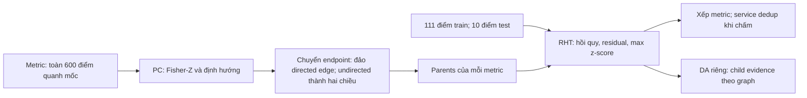

# Hồ sơ CIRCA-PC — biến thể RCAEval

Phạm vi: kỹ thuật của biến thể `circa` trong RCAEval, đối chiếu CIRCA gốc. Revision và hash ở `paper/source-manifest.json`. `RE:` dưới đây là đường dẫn tương đối trong `D:/RCA-ext/src/RCAEval/`; `CIRCA:` là trong `D:/RCA-ext/work/T-014/CIRCA/`. Ví dụ mặc định đã được tính lại độc lập từ raw input tới từng điểm số. Hồ sơ phục vụ P1/G1; cấu hình P3 còn OPEN.

## 1. Bài toán và đầu vào

CIRCA-PC nhận bảng metric theo thời gian và một mốc sự cố đã biết. Mỗi metric là ứng viên. Nó trả danh sách metric cần kiểm trước. Nó không tự phát hiện lúc sự cố bắt đầu và không chứng minh một service là nguyên nhân vật lý của sự cố.

Bảng cần cột `time` theo Unix seconds; metric numeric có tên `service_metric`. Hàm chính giữ `time`, xử lý cột rồi học PC trên tất cả hàng đầu vào, không chỉ normal window (`RE:RCAEval/e2e/circa.py:18–35`). Nó không cần trace hay đồ thị gọi có sẵn. Mốc `inject_time` được đưa vào RHT (`circa.py:35`), với nghĩa mốc biết trước ở phép kiểm tái lập.

Ứng viên thực tế hẹp hơn mọi cột đầu vào: PC preprocessing có thể bỏ cột hằng; wrapper `rht` chỉ đưa metric có cạnh vào graph; `CaseData.prune=True` bỏ chuỗi hằng trong cửa sổ nạp. Tập ứng viên này phải lưu cùng thứ hạng. Nhãn root chỉ được đọc sau khi đã lưu điểm.

## 2. Từng bước xử lý và công thức

**Bước 1 — chuẩn bị dữ liệu.** Với `dataset` khác None và khác `causalrca-sock-shop`, bỏ time/cột hằng trên toàn bảng, đổi cột `_mem` từ byte sang MB. Nếu `dk_select_useful=True`, còn lọc cột extra/near-constant và chọn kênh hữu ích. Mặc định của lời gọi CIRCA là False (`RE:RCAEval/io/time_series.py:99–111`; `e2e/circa.py:24`).

**Bước 2 — học graph.** PC (Peter–Clark, khám phá quan hệ có điều kiện) khởi đầu từ graph đầy đủ, xóa cạnh khi conditional independence test (phép kiểm độc lập có điều kiện) không bác bỏ độc lập. Fisher-Z dùng partial correlation (tương quan riêng phần). Nó định hướng collider rồi áp các luật định hướng. PC có thể giữ cạnh chưa định hướng. `pc_default` dùng toàn bộ `pc_input` đã bỏ time; không đọc mốc sự cố (`RE:graph_construction/pc.py:12–21`). Đây không phải structural graph của bài CIRCA.

Với a,b và tập điều kiện S, lấy ma trận correlation của {a,b}∪S rồi nghịch đảo thành K. Code tính r=−K₀₁/√|K₀₀K₁₁|, T=√(n−|S|−3)·|atanh(r)| và p=2·(1−Φ(T)). Nếu p>alpha, cạnh bị đánh dấu xóa ở mức depth=|S|. Stable=True gom cạnh xóa để bỏ sau toàn lượt depth. Source: causal-learn `utils/cit.py:138–171`, `SkeletonDiscovery.py:61–116`. Nghịch đảo singular ném ValueError; r bị clip khi |r|≥1, nhưng clipping không chữa ma trận không nghịch đảo được hoặc NaN.

**Bước 3 — chuyển endpoint PC thành cha/con.** Với cặp có hai endpoint −1, vòng lặp trên cả `(a,b)` và `(b,a)` thêm hai hướng. Với causal-learn, a→b có `adj[a,b]=−1, adj[b,a]=1` (`causallearn/graph/GraphClass.py:100–102` của môi trường ghim). RCAEval thêm a→b ở nhánh này, rồi reverse tại dòng341, nên scorer nhận b→a. Đây là đảo hướng directed PC, không chỉ đổi cách vẽ; parent set của regression đổi theo nó. Đồ thị không add_nodes từ danh sách cột: metric không có cạnh biến mất (`RE:graph_heads/rht.py:307–342`). Phải kiểm graph rỗng và chu trình, không coi mọi output của PC là causal DAG. Hệ quả về chênh số phải dựa phép kiểm của nhánh audit, không suy từ fixture rằng nó giải thích toàn bộ khoảng lệch.

**Bước 4 — nạp cửa sổ.** `CaseData` nhận interval=1 giây, lookup_window=120 và detect_window=10. Gọi tại `current=t_d+300`. Vì vậy nó nạp khoảng `[t_d−120,t_d+300]`, lấy 111 mẫu đầu để fit và 10 mẫu cuối để chấm (`RE:classes/data.py:163–177,225–243`; `graph_heads/rht.py:362–365,174–177`). Nếu đủ dữ liệu 1 giây, train là `t_d−120…t_d−10`, test là `t_d+291…t_d+300`. Loader resample theo origin=start, lấy mean tại timestamp trùng, interpolate rồi bfill (`classes/data.py:89–108`). Các mẫu ở giữa không đi vào regression hoặc test score, dù PC có thể đã dùng chúng.

**Bước 5 — hồi quy theo parents.** Với node i, ký hiệu `P_i` là các cha còn có dữ liệu. Ký hiệu `N` là các mẫu train. Với cấu hình mặc định tau=0, fit linear regression có intercept:

\[
\widehat\beta_i,\widehat b_i=\arg\min_{\beta,b}\sum_{t\in N}\bigl(x_i(t)-b-\beta^\top x_{P_i}(t)\bigr)^2.
\]

Tính residual `e_i(t)=x_i(t)−b̂_i−β̂_iᵀx_{P_i}(t)`. Fit StandardScaler trên residual train: `μ_i=mean_N(e_i)`, `σ_i²=mean_N((e_i−μ_i)²)` (ddof=0). Với `Q` là cửa sổ test:

\[
z_i(t)=\frac{e_i(t)-\mu_i}{\mathrm{scale}_i},\qquad s_i=\max_{t\in Q}|z_i(t)|,\qquad c_i=1-2\Phi(-s_i).
\]

`scale_i` là scale của StandardScaler; nó không nhất thiết bằng σ_i khi phương sai bằng hoặc gần 0. Confidence `c_i` là biến đổi score theo giả định Gaussian, không phải xác suất root cause đã được calibration (hiệu chỉnh xác suất) trên dataset. Code chọn `s_i`, vì use_confidence=False (`RE:rht.py:133–147,155–165,213–227`).

Node không có parents dùng z-score trực tiếp trên `x_i`, không cần hồi quy. Một ValueError trong regressor cũng chuyển sang z-score trực tiếp và ghi warning (`RE:rht.py:118–124`); trường hợp này phải ghi là nhánh dự phòng ở mức node. Khác với wrapper dự phòng ở mức cả ca.

**Bước 6 — xếp hạng.** RHT trả score cho metric; s lớn xếp trước. Khi cùng key, sorted giữ thứ tự dictionary, vốn phụ thuộc set/hash (`RE:rht.py:350–358,366`). Gộp sang service bằng lấy lần xuất hiện đầu tiên là bước đánh giá/adapter, không phải CIRCA tự chấm service.

**DA để kiểm cơ chế.** Dù bản chính không gọi DA, lớp DAScorer có sẵn. Trên DAG, dùng score gốc s và ngưỡng θ=3:

\[
D_i=\{s_j:j\in Ch(i)\}\cup\bigcup_{j\in Ch(i):s_j<\theta}D_j,
\quad s'_i=s_i+\mathbf1[s_i\ge\theta]\max(D_i\cup\{0\}).
\]

Thu thập D từ lá lên trước khi sửa s. Tức node đủ bất thường được cộng score child lớn nhất; khi child dưới ngưỡng, bằng chứng của descendants có thể đi xuyên child đó. Đây không phải cộng mọi descendant hay PageRank. Code giữ node dưới ngưỡng trong output và đặt key `(s'_i,−topological_index_i,s_i)` (`RE:rht.py:254–287`). Với cyclic graph, `topological_sort` gom SCC rồi lấy generation; thứ tự bên trong một SCC không có thứ tự nhân quả (`RE:classes/graph.py:12–32`).

Kiểm code chính thức bằng hashseed0–5 trên fixture không có dataset/nhãn đã cho hai score vectors ở cycle, trong khi DAG chỉ có một (`audit/da-cycle.json`). Với edges a→b, b→c, c→b, score a=4,b=1,c=4, DA của c có thể bằng8 hoặc5 khi đổi thứ tự {b,c}; đây là thay điểm, không chỉ phá hòa thứ hạng. Một đường vòng còn có thể đưa score c trở lại evidence của chính c. Không suy fixture này thành mọi PC đều bị thay điểm; cần biết SCC và score của từng ca. Nó đủ để không diễn giải DA trên graph cyclic như phép suy ancestor theo DAG.

## 3. Đồ thị dùng ở đâu, theo K1 §3

| Vai trò | CIRCA-PC dùng graph thế nào |
|---|---|
| FEATURE_CONTEXT — ngữ cảnh đặc trưng | Parent set quyết định biến giải thích regression; thay graph có thể đổi residual và s_i. |
| CAUSAL_REASONING — lập luận nhân quả | Ý định là học/định hướng quan hệ rồi diễn giải conditional deviation; code thực thi đảo directed edges, còn cạnh chưa định hướng thành hai chiều. Vì vậy không giữ nguyên bảo đảm causal parents của bài. |
| ROOT_CAUSE_RANKING — xếp ứng viên | RHT xếp conditional score. Trong kiểm DA, quan hệ child/ancestor đi vào điểm cuối. |

Graph không chỉ dùng sau anomaly score. CIRCA không chứa detector cấp hệ thống hay vùng ảnh hưởng được xác thực. Đồ thị PC và chỉ tiêu confidence không tự chứng minh quan hệ cause→effect thật.

## 4. Tham số mặc định và file:dòng

| Thành phần | Giá trị | Nguồn kiểm |
|---|---|---|
| PC alpha | 0.05 | causal-learn ghim `search/ConstraintBased/PC.py:22`; `pc_default` không truyền override |
| PC CI test | fisherz | `PC.py:23` |
| Stable skeleton | True | `PC.py:24` |
| Collider rule/priority | 0/2 | `PC.py:25–26` |
| Background knowledge | None mặc định | `RE:graph_construction/pc.py:12–20`, with_bg=False |
| Maximum depth | không cap; dừng theo max_degree | causal-learn `utils/PCUtils/SkeletonDiscovery.py:62–65` |
| Regression | LinearRegression() | `RE:graph_heads/rht.py:135` |
| Lag tau | 0 | `rht.py:157` |
| Aggregator | max | `RE:graph_heads/random_walk.py:108` |
| use_confidence | False | `rht.py:159` |
| Interval/current | 1s / t_d+300s | `rht.py:362,365` |
| Lookup/detect/prune | 120/10/True | `RE:classes/data.py:164–166` |
| DA trong CIRCA-PC chính | không gọi | `rht.py:345,365` |
| DA khi kiểm | threshold=3, max | cấu hình gốc `CIRCA:circa/experiment/comparison/models.py:629–634`; lớp mặc định threshold=0 không phải lựa chọn này |

Chuỗi `dataset="ob"` truyền vào pc_default ở `circa.py:34` không làm áp background knowledge hay chọn schema: kwargs không được dùng ở hàm pc_default. Muốn thay alpha/depth cần adapter/lời gọi khác và tên biến thể khác.

## 5. Chỗ code khác bài

- Graph học từ toàn cửa sổ bằng causal-learn, thay graph kiến trúc có metric mapping.
- Cạnh directed causal-learn bị đảo sau `graph.reverse()`; cạnh chưa định hướng thành hai chiều. Parent set thực thi vì vậy khác cách hiểu causal parents của paper. Nhánh audit có phép kiểm directed fixture và code backend; chưa tự quy mọi chênh số vào lỗi hướng này.
- Scorer chính là RHT-only + LinearRegression. Cấu hình empirical của bài là RHT+DA + SVR(sigmoid). Mốc số bài lưu ở `paper/cong-bo-circa.csv`; không gắn mốc này với bản đang chạy.
- Paper §4.3 mô tả loại s<3 khỏi root-cause indicators. Pseudocode DA không có bước filter/delete/ranking rõ, còn code giữ toàn bộ scored metrics. Trong code, θ3 quyết việc nhận child score/truyền evidence ở DA, không phải incident detector hoặc cutoff output; RHT-only không có θ3. Đối chiếu và đề xuất K1 ở `paper/dinh-chinh-k1-threshold.md`.
- Interval=1s làm lookup/detect tương ứng 120s/10s; default CIRCA gốc interval=1min (`CIRCA:circa/model/case.py:27–30`).
- Có hai mức fallback: regressor ValueError→N-Sigma; wrapper `@rca`→thứ tự cột. Output không lỗi chưa đủ kết luận chạy đúng.
- SLI chọn ngẫu nhiên nhưng RHT không đọc data.sli: nó dùng graph parents và toàn series có trong graph (`RE:rht.py:349,213`; `RE:classes/data.py:223`). Không được dùng nhãn root để chọn SLI.
- Metric không có dấu `_` có thể gây IndexError ở parser; metric có nhiều `_` bị lấy chỉ phần thứ hai (`rht.py:308,350–356`). Không gọi đây là bỏ cột vô hại: có thể chập identity hoặc thiếu dữ liệu.
- Output `node_names` của e2e/circa.py gồm `time`, trong khi adj chỉ dành cho metric (`circa.py:29–39`). Fixture đã có adj4×4 nhưng node_names5. Consumer muốn dựng graph phải lấy identity của pc_input và loại time; không align adjacency trực tiếp với field này. Điều này chưa chứng minh consumer nào trong task cũ đã sai.

**CANDIDATE scorer chung:** RHT-only cho PC/kiến trúc là lựa chọn giữ scorer/cửa sổ cố định để đối chiếu hai cấu hình, đồng thời bám bản RCAEval. Tập ứng viên, parent sets và chiều cạnh vẫn khác nên chưa cô lập tác động nguồn đồ thị. Phương án PC theo RCAEval và kiến trúc theo SVR+RHT+DA của bài được xét riêng trong nháp WHY. Nó chưa phải chốt P3 và không phải full CIRCA Oracle. **(chờ WHY, xem de-xuat-tai-lieu-chung.md)**

## 6. Giả định và điều kiện thất bại

Bài gốc cần DAG, Markovian (ngoại sinh giữa các node độc lập) và Faithfulness (can thiệp tạo đổi quan sát được). Tác giả nêu thiếu meta-metric có thể tạo hidden common cause và hiểu normal distribution chưa đủ. DA cần kiểm trên thêm dữ liệu thật. [Nguồn: CIRCA §2.1/7/5.3.4](https://netman.aiops.org/wp-content/uploads/2022/08/KDD22-CIRCA.pdf).

Riêng RHT §4.2 giả định residuals theo phân phối normal độc lập và đồng phân phối (i.i.d.). H0 là metric vẫn theo conditional distribution bình thường khi biết parent values hiện tại. Hồi quy chỉ là proxy của structural equation; z-score là phép xấp xỉ phép kiểm đó. Với residual tự tương quan, phân phối lệch Gaussian, parent range sau fault ngoài normal reference hoặc regression sai, confidence không giữ cách diễn giải xác suất của giả định. Tác giả minh họa thiếu coverage normal ở Figure1 và dùng DA để giảm bias này, không chứng minh DA chữa mọi misspecification.

Điều kiện kỹ thuật rút trực tiếp từ code, không tự là hạn chế đã đo của RE2-TT: PC Fisher-Z lỗi khi covariance singular; conditional regression sai khi quan hệ phi tuyến hoặc normal sample không phủ parent values lúc fault; residual nhỏ gây score rất lớn; graph rỗng gây output rỗng; hash/tie ảnh hưởng rank; malformed names có thể mất ứng viên. Cần kiểm các yếu tố này trước khi gọi một score lớn là root evidence. Parent graph sai, model sai hoặc sampling/interpolation sai đều là giải thích thay thế.

Fixture nhỏ đã tách ba trường hợp (`paper/pc-fixtures-002/fixture-results.json`): constant đưa thẳng vào PC có thể trả graph dù CI chứa NaN, nhưng preprocessing chính loại constant; duplicate columns tạo singular ValueError và wrapper trả thứ tự cột kèm stderr; PC rỗng trả ranks=[] mà không exception/fallback. Vì vậy phải kiểm finite intermediates, candidates và output, không chỉ kiểm exitcode. Fixture không thay kiểm default RE2-TT ở quy mô đầy đủ; prefix depth0/1 là cấu hình khác.

## 7. Ví dụ tính tay

Ca `re2tt_ts-order-service_loss_3` được chọn trước điểm theo số cột processed nhỏ nhất trong 30 ca dev; nếu hòa dùng tên ca tăng dần (`runs/selection-before-scores.json`). PC default alpha0.05/Fisher-Z/stable, không cap depth, hoàn tất trên EC2 (`runs/ec2-default-003/adj.npy`). Metric minh họa là top1 RHT đã lưu: `ts-order-service_latency`. Nhãn chỉ mở sau ranking.

Toàn bộ từng bước, 10 test points, parents, hệ số, residual train scale, DA và ties ở `paper/vi-du-pc.md`/`.json`. Với111 train points và4 parents, OLS có rank3; một parent socket hằng trên train nên hệ số0 nhưng regressor không fallback. μ residual=7.329597389487591e−16, variance=6.193752929139483e−08, scale=0.0002488725161430945. Test tại t_d+296 có y=0.3999999999999999, prediction=0.02287730601316862, residual=0.3771226939868313 và z=1515.3247929152449. Max|z| bằng giá trị này. Score lớn vì normal residual scale nhỏ so với test deviation, không tự chứng minh mọi parents hoặc quan hệ fault đúng.

DA dùng child score lớn nhất1237.93406616552 nên score latency thành2753.258859080765. RHT và DA service rank đều1 sau dedup theo lần xuất hiện đầu. RHT metric tiếp theo score1237.93406616552; latency của service gốc vượt nó. Các metric khác của service này có hạng72,94,115,139,190; không phải tất cả cùng đứng đầu.

Tất cả270 scored nodes/2160 numeric checks khớp code chính thức; max absolute error2.220446049250313e−16 (`paper/compare-example-pc-001/comparison.json`). Kiểm raw preparation/resample/candidate/parents có1080 arrays PASS sai số0 (`paper/window-example-pc-001/window-comparison.json`). Kiểm adjacency bytes/name/endpoint PASS (`paper/pc-source-alignment.json`):273 PC metric→271 graph nodes/896 edges→270 scored metric. PC input dừng ở t_d+299, nên test endpoint+300 được nearest fill từ+299; raw file đầy đủ còn dữ liệu sau đó.

Graph không DAG; SCC chứa latency có149 node. DA comparison dùng thứ tự DAScorer thực tế được snapshot ghi, nên khớp số không xóa rủi ro thứ tự SCC. Có2 nhóm hòa RHT score,3 nhóm hòa DA score và1 nhóm hòa full DA key; không hòa top1. Adapter hiển thị lexical trong nhóm hòa, khác tie order core có thể phụ thuộc set/hash. Ví dụ default này không thay tái lập số paper, không chứng minh calibration và không chọn scorer theo root rank.

**Quy mô và kiểm trên ca thật.** PC mặc định học 600×273, hoàn tất trên EC2 sau1796.2688s; RHT0.8317s và270 score hữu hạn. Supervisor quan sát peak RSS5,204,905,984B. Đây là thời gian có instrumentation, không phải benchmark sạch: máy dùng chung, monitor chỉ chứng minh không thấy Python/R worker khác trong lượt hoàn tất, không loại trừ tải nền. Hai lượt dừng360.1923/780.3469s vẫn tính vào tổng. Nguồn: `runs/ec2-default-003/progress.jsonl`, `supervisor.jsonl`, `status.json`; tổng ngân sách ở `runs/chi-phi-tong.json`.

**Phân biệt phép kiểm.** Scorer trên graph lưu sẵn lặp và đảo cột khớp; nó chưa chứng minh PC discovery bất biến theo permutation. Lượt xếp hàng đầu tiên không có worker được giữ trong lịch sử; full PC permutation trên EC2 thứ hai đã xong và không đạt bất biến (`bo-sung-ec2.md`). Control normal/normal dùng fault graph lưu sẵn có76/268 metric≥3; đây chỉ là kiểm scorer có điều kiện, không thay full normal-PC đã học riêng.

**Đặt cửa sổ lỗi cạnh đối chứng.** Cửa sổ lỗi có88/270 metric với RHT score≥3, trong đó82 có cha; đối chứng full normal-PC trước tiêm có93/270, trong đó85 có cha. Đầu vào PC khác: lỗi600×273, đối chứng720×275; đây chỉ là số cùng bậc, không dùng hiệu5 để suy lỗi làm tăng/giảm bất thường. Hai mốc và regime khác nhau; pre-injection chưa được xác nhận độc lập là khỏe. Ngưỡng3 thuộc cơ chế DA, không phải detector đã calibration. Không gọi top1 normal là root có nghĩa hoặc số này là tỷ lệ báo nhầm toàn dataset. Nguồn: `runs/example-pc/snapshot.json`; `runs/normal-normal-pc-official-capture/snapshot.json` và `runs/ec2-2-normal/scores.json` (điểm chính thức); input shape ở `runs/ec2-2-normal/input.json`. Snapshot laptop cho cùng số đếm nhưng bốn điểm khác, nên không dùng nó thay điểm chuẩn EC2. Control fault graph lưu sẵn ở `runs/pc-cached-checks.json`.

Graph ca thật có112SCC tổng, trong đó6SCC nhiều hơn một node, lớn nhất149. RHT trên hashseed0/1 được so riêng với DA trong `paper/crossseed-pc.json`: RHT0/270đổi vượt tolerance; DA25/270đổi, chênh lớn nhất1509.1518. Giữ RHT cố định và chỉ đổi actual iteration order vẫn tái hiện25thay đổi DA. Đây là kiểm thực thi, không bảo đảm suy ancestor trong SCC. PCdepth0 alpha.05 trên cùng273biến chưa trả graph sau2703.969s trên laptop dùng chung; không suy cap depth luôn rẻ hơn. Chưa lấy stack để phân xử chi phí orientation và skeleton, nên nguyên nhân runtime còn OPEN. Nguồn: `runs/pc-depth0-alpha005/status.json`.

**Điều tra số công bố.** Ô MEMfseOB của T006 Avg5=.888, so mốc công bố=.74. Trên25ca MEM đã được phép chạy trước, backend R/pcalg gốc với linearRHT cho.864; SVR cho.960; linear+DA cho.856; SVR+DA cho.864 (`audit/mem-target-summary.json`, `audit/mem-prior-config-summary.json`). Không cấu hình nào tái lập.74. Backend, hướng cạnh và coverage cùng đổi ở đối chiếu graph; phần giảm.024 không tách được thành đóng góp riêng của mỗi yếu tố. Scorer gốc và RCAEval dùng cùng graph/window khớp trên2ca (`audit/summary.json`); vì vậy chưa có bằng chứng quy toàn khoảng lệch cho công thức RHT. Giao thức sinh bảng công bố, windows/preprocessing/phiên bản cụ thể vẫn OPEN; cần lệnh/artifact tương ứng để phân xử. Không chọn biến thể từ độ khớp hay accuracy.

## 8. Đường nhãn có thể lọt vào phương pháp

- Mốc inject_time là đầu vào chế độ tái lập; trong tự phát hiện nó là nhãn cấm. Cửa sổ đã cắt quanh mốc cũng mang thông tin từ nhãn, dù không đưa file nhãn trực tiếp.
- Tên ca chứa service/fault; runner chỉ dùng chọn file được phép và phải tách khỏi graph/scorer inputs.
- Chọn cột, SLI, roots hoặc candidate services theo fault label làm rò đáp án. Lọc cột theo schema/preprocessing đã chốt khác với lọc theo nhãn.
- PC dùng dữ liệu fault sau mốc nên graph phản ánh cả intervention regime. Đó là thông tin outcome trong telemetry, không phải root label trực tiếp; không được gọi nó là graph healthy độc lập với incident.
- Top-k chấm trên service sau dedup không cùng universe metric của bài gốc. Nó cần nhãn để đánh giá, không dùng nhãn để tạo thứ hạng.

## 9. Yêu cầu đầu vào trên dataset khác

Bảng numeric, `time` Unix seconds, identity metric không mơ hồ, một mốc phát hiện từ ngoài, đủ normal reference và fault tail để nạp cửa sổ. Với wrapper RCAEval cần tên `service_metric` đúng một separator `_`; nếu tên khác phải adapter lossless và ghi khác biệt. Không cần root labels để học. Cần đủ số mẫu so với số parents và Fisher-Z condition set; cột hằng/trùng và missingness phải được ghi rõ. Không có mức normal tối thiểu phổ quát bảo đảm hiệu quả: 111 điểm nội suy không đồng nghĩa 111 quan sát độc lập.

Tổng chi phí gồm PC graph discovery và regression toàn metric; PC không cap depth có thể rất đắt ở Train Ticket. Thời gian task phải lấy từ run log, không chuyển thời gian Oracle hoặc laptop đang tranh tải thành chi phí chính thức. Trace/log là tùy chọn nếu chỉ CIRCA-PC metrics; biến thể mmcirca thuộc phạm vi khác và không tự đồng nhất với hồ sơ này.

Adapter `src/circa_kien_truc/scoring.py` của T014 chỉ hỗ trợ các suffix đã mapping, đủ ca TT đang kiểm. Wrapper PC gốc chỉ tách `service_metric`, có thể nhận suffix khác như load; không suy adapter T014 là triển khai PC phổ quát.

**Kiểm định hướng bổ sung.** Full-PC đảo cột trên cùng ca có skeleton giống trước nhưng667cặp endpoint và258/270điểm đổi vượt tolerance; topmetric vẫn order_latency nhưng điểm1515.32479→1382.262465. Khác host/compiler là giải thích khác cần giữ. Fixture cùng máy chỉ đổi nodeorder, giữ separating sets, đã tái hiện hướng khác với`uc_priority=2`; ruleđộc lập khớp. Tùy chọn`stable=True` không bảo đảm định hướng bất biến: nó áp dụng bước xóa cạnh, còn ưu tiên collider đãđịnhhướng phụthuộc thứtự duyệt. Nguồn: runs/ec2-2-permuted/comparison.json, paper/orientation-order-fixture.json. Không sửa cấu hình để ép kiểm này đạt; chưa quy từngcạnhcaTT cho một cơchế duy nhất.

**Bổ sung kiểm EC2₂ (04/10, trạng thái hiện hành).** Đảo cột/học lại PC: hoàn tất 1725.452s; 667 cặp endpoint đổi, 258 điểm đổi vượt tolerance; cùng candidate=True. Direct RHT/snapshot, số học độc lập và raw arrays đều PASS. Full normal-PC học trên 720×275 điểm/cột trước tiêm: hoàn tất 1917.001s; 93/270 điểm≥3, top ts-security-service_mem=957.1628. RHT chính thức lặp lại cùng máy khớp từng điểm; số học độc lập trên EC2 và raw arrays PASS. Đối chiếu laptop FAIL ở bốn metric; xem normal-doi-chieu-so-hoc.md. Chi phí và giới hạn đối chiếu host ở `bo-sung-ec2.md`; bằng chứng từngkhối ở `runs/ec2-2-permuted/`, `runs/ec2-2-normal/`, `paper/followup-*/`. Các nhận xét chưakiểm trong đoạn trước là trạng thái trước khi Minh yêu cầu tiếp tục; trạng thái hiện hành của hai phép kiểm là đoạn này.
