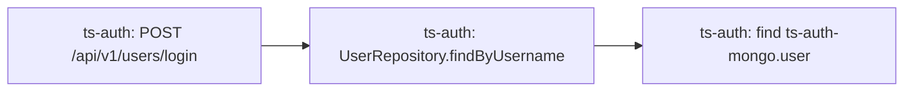

# Ví dụ MicroRank trên một ca dev Train Ticket

Ca `re2tt_ts-auth-service_cpu_1` được chọn trước khi chạy theo SPEC. Đây là **MicroRank-RCAEval sửa đầu vào**, giữ luật span μ+3σ và dùng PageRank/spectrum của code gốc. Không gọi đây là tái lập detector MicroRank gốc. Các số dưới đây lấy từ snapshot `runs/tt-local/auth/example.json`, kết quả độc lập `runs/tt-independent-math/auth/` và bản trích đọc được `runs/independent-math/tt-auth-extract/output-exact-prior/example-extract.json`.

## 1. Đầu vào và kiểm độc lập

Bộ đọc lấy span có startTime trong [mốc−600s, mốc+600s). Cửa sổ có 957.209 span thuộc 5.568 trace; 474.132 span kết thúc trước mốc dùng học ngưỡng, 483.077 span kết thúc từ mốc trở đi dùng RCA. Có 5.036 span vượt hoặc bằng μ+3σ. Chia một lần ở mức trace cho 1.326 trace bình thường và 1.403 trace bất thường; giao hai tập bằng 0. Một span bất thường đủ đưa mọi span **phía sau mốc đang quan sát** của trace đó vào nhóm bất thường. Nguồn: `runs/tt-local/auth/primary-summary.json`, mục `counts`, `census` và `io_metadata`.

Hai script độc lập không gọi hàm tác giả để tính:

- `scripts/independent_inputs.py` đọc lại raw parquet của đúng ca dev này, tính mean/sample-std bằng `math.fsum`, chia nhóm, dựng cạnh bằng parent join theo `(traceID,spanID)` và dựng incidence bằng nhóm tập. 19 phép đối chiếu với snapshot đều đạt; xem `runs/tt-independent-inputs/auth/comparison.json` và `input-calculation.json`.
- `scripts/independent_math.py` tự dựng ma trận, prior, 25 vòng PageRank, trọng số, mọi ô spectrum và Dstar2. 4.383 phép so sánh với hàm chính thức đều có sai số tuyệt đối và tương đối bằng 0; xem `runs/tt-independent-math/auth/comparison.csv`, `summary.json`.

Phép kiểm thứ nhất đã chỉ ra đúng quan hệ và phân nhóm, nhưng bộ đếm root của snapshot cũ chưa nhận token `<NA>` từ pandas. 19 phép so ban đầu dùng cùng quy ước token nên không tự phát hiện lỗi ngữ nghĩa null này. Lỗi chỉ ảnh hưởng cách gọi root/missing-parent trong audit; không đổi cạnh, incidence hay điểm. Không dùng các số `explicit_root_spans=0` của snapshot cũ làm bằng chứng mất root. Bản raw correction `runs/root-audit-correction/auth/audit-correction.json` xác nhận root1.326/1.403, missing-parent0/0, cả4relations mỗi phía khớp tuyệt đối. Root marker không chứng minh frontend-server root theo policy gốc. Probe `runs/tt-trace-vector-probe/auth/summary.json` so trực tiếp2.729 trace PPV và298 operation PPV với locals của hàm gốc không sửa source:3027comparisons sai số0. Vì vậy vector trace trong ví dụ có đối chiếu trực tiếp, không chỉ suy từ operation output.

Các file `normal/anomaly-operations.csv` và `normal/anomaly-traces.csv` chứa mọi phần tử vector và trọng số; `spectrum-scores.csv` chứa mọi ô và điểm. Ví dụ chỉ làm tròn số hiển thị. Chứng nhận khớp dùng số đầy đủ trong CSV/JSON.

## 2. Đồ thị operation

| Phía | Operation | Cạnh gọi duy nhất | Trace | Span occurrence | Loại trace theo tập operation |
|---|---:|---:|---:|---:|---:|
| Bình thường | 146 | 191 | 1.326 | 71.892 | 21 |
| Bất thường | 152 | 199 | 1.403 | 411.185 | 28 |

Incidence ghi operation có xuất hiện trong trace, không ghi số lần lặp. Scope trong prior lại dùng số occurrence: 71.892+411.185=483.077 span phía sau mốc. Hai đại lượng vì vậy không được thay cho nhau. Nguồn bảng: `runs/independent-math/tt-auth-extract/output-exact-prior/example-extract.json`.

Đồ thị đầy đủ được lưu bằng danh sách cạnh trong `normal-operation-edges.csv` và `anomaly-operation-edges.csv` cùng thư mục trích. Mỗi dòng có out-degree của nguồn và hệ số A. Tập node đầy đủ ở các file `*-operations.csv` của phép tái tính, kể cả node không có cạnh.

Một phần đồ thị của auth giống nhau ở cả hai phía:

Mỗi nguồn ở đoạn này có một con, nên hệ số A trên hai cạnh bằng 1. Auth không có cạnh **giữa các service**, nhưng có cạnh nội bộ operation và liên kết với trace. Vì vậy thiếu cạnh liên service không làm auth biến mất khỏi thứ hạng.

Operation đứng đầu theo điểm đã lưu là `S = ts-station-service_find ts.station`. Trong phía bình thường, nó nhận cạnh từ `StationRepository.findByName`. Trong phía bất thường, nó nhận thêm cạnh từ `StationRepository.findById`. Mỗi nguồn có một con, nên tổng hàng A đi vào S lần lượt là 1 và 2. S không có cạnh đi ra. Chọn S vì nó có điểm cao nhất và xuất hiện ở cả hai phía; quy tắc này không dùng nhãn lỗi.

## 3. Ma trận và prior của hai trace cụ thể

Ma trận có cột là nguồn: A nối operation cha→con; B nối trace→operation và chia cho số operation duy nhất trong trace; C nối operation→trace và chia cho số trace có operation đó. Phía bình thường có A:146×146, B:146×1.326, C:1.326×146; phía bất thường có A:152×152, B:152×1.403, C:1.403×152. Tất cả phần tử A/B/C/prior được lượng tử hóa thành float32 trước khi nhân. Vectors chạy bằng float64.

Chọn trace theo ID nhỏ nhất ở mỗi nhóm, không dùng nhãn:

| Phía | ID trace | Operation duy nhất | Occurrence | Số trace cùng loại | Prior | Trace PageRank sau 25 vòng |
|---|---|---:|---:|---:|---:|---:|
| Bình thường | `001041b9bd45e739c0dc21e56e6a29f2` | 5 | 5 | 92 | ≈0,00051759835 | 0,060585723971385 |
| Bất thường | `0013f5e356c0c086a50003c53a76a035` | 3 | 5 | 439 | ≈0,0006360732 | 0,020020060948325 |

Trace bình thường đi qua admin-basic-info và price. Cột B có năm phần tử bằng 1/5. Trace bất thường đi qua ba operation auth của sơ đồ trên; cột B có ba phần tử bằng 1/3, dù có năm occurrence. Nguồn: các file `*-traces.csv` và bản trích JSON.

Phía bình thường có $K=\sum_t1/k_t=21$. Vì vậy prior của trace đầu là

\[
u_p=\frac{1/92}{21}=\frac1{1932}\approx0.00051759835.
\]

Phía bất thường có $K=28$ và $S_m=\sum_t1/m_t=97.77897211793864$. **Biểu thức code** cho trace thứ hai là

\[
u_f=\frac{0.5}{S_m(0.5\times439/28+1/5)}\approx0.0006360732.
\]

Prior bình thường có tổng 1; prior bất thường có tổng 5,83726167678833. Prior thứ hai không phải phân phối xác suất và không phải hỗn hợp cộng của phương trình (7) trong bài. Các trace PageRank ở bảng là vector được tái tính độc lập; kiểm trực tiếp local vector của hàm chính thức được bổ sung bằng probe riêng, không sửa kernel.

## 4. PageRank ở hai phía

Khởi tạo mọi phần tử operation/trace bằng $1/(M+N)$. Mỗi vòng cập nhật đồng thời từ hai vector cũ:

\[
\tilde s=0.85(Br+0.01As),\quad \tilde r=0.85Cs+0.15u,
\qquad s=\tilde s/\max\tilde s,\quad r=\tilde r/\max\tilde r.
\]

Ở vòng đầu, tổng hàng B đi vào S là 17,26525768544525 phía bình thường, 37,47114612534642 phía bất thường. Với các entry float32 đã dựng:

\[
\tilde s^p_S=\frac{0.85}{146+1326}(17.26525768544525+0.01\times1)
\approx0.00997552244,
\]
\[
s^p_S=0.00997552244/0.07545867525591786\approx0.13219848.
\]

Tương tự phía bất thường:

\[
\tilde s^f_S=\frac{0.85}{152+1403}(37.47114612534642+0.01\times2)
\approx0.02049355254,
\qquad s^f_S\approx0.25618622.
\]

Với trace đại diện, tính hàng C nhân vector operation ban đầu rồi cộng 0,15u. Phía bình thường cho $\tilde r_t\approx0.00010112739$; chia max trace 0,011583749000526396 được $r_t\approx0.00873011$. Phía bất thường cho $\tilde r_t\approx0.00009914645$; chia max 0,03651478016773355 được $r_t\approx0.00271524$. Các số vòng đầu là phép thay số đọc được; kết quả full precision theo đúng thứ tự nhân số thực nằm trong script và CSV.

Mỗi vòng tiếp theo phải cập nhật cả hai vector; không giữ trace vector cố định. File `*-iterations.csv` ghi max trước chuẩn hóa và thay đổi từng vòng. Sau vòng 25, trọng số operation là $w_o=s_o\sum_js_j/M$:

| Operation | s bình thường | w bình thường | s bất thường | w bất thường |
|---|---:|---:|---:|---:|
| S: `ts-station-service_find ts.station` | 0,193159285344957 | 0,0158615100987801 | 0,460491809897699 | 0,0580537938731510 |
| D: `ts-auth-service_find ts-auth-mongo.user` | 1 | 0,0821162185936522 | 1 | 0,126069112686386 |

Hệ số nhân chung $\sum s/M$ là 0,08211621859365216 và 0,12606911268638626. D có PageRank operation cao nhất ở cả hai phía nhưng điều đó chưa quyết định điểm nghi ngờ.

**Không có bằng chứng hội tụ tại vòng 25:** max thay đổi operation/trace của vòng này là 0,598831/0,347665 ở phía bình thường và 0,539508/0,550659 ở phía bất thường. Đây là quan sát trên một ca, không là kết luận tần suất trên dataset. Hàm tác giả dừng vì đủ 25 vòng; nó không có ε dừng. Không đổi số vòng sau khi nhìn nhãn để cải thiện thứ hạng.

Probe chẩn đoán tái dùng hai hàm toán độc lập, không gọi hàm tác giả hoặc chạy lại ca. Cùng graph/prior/$d=0.85,\alpha=0.01$; số vòng 25/26/50/100/101 cố định trước kiểm. $\Delta s$ dưới đây là max thay đổi operation giữa vòng cuối và vòng ngay trước đó, không phải sai số so với tác giả:

| Số vòng | Δs normal | Δs anomaly | Full khác vòng25? | Top11 khác vòng25? |
|---:|---:|---:|---|---|
| 25 | 0,598831 | 0,539508 | không | không |
| 26 | 0,598570 | 0,539508 | có | có |
| 50 | 0,595798 | 0,400551 | có | có |
| 100 | 0,591774 | 0,366982 | có | có |
| 101 | 0,591771 | 0,356210 | có | không |

Nguồn: `runs/review-response/iteration-probe.json`, script `scripts/check_review_diagnostics.py`. Vòng 25 khớp mọi score lưu, sai số tuyệt đối và tương đối 0. Ngay 100/101 còn thay đổi lớn; top 11 giống nhau không chứng minh vector hội tụ. Giữ 25 theo cấu hình code; không chọn vòng cho root rank tốt hơn. Probe chỉ mô tả độ nhạy của một snapshot, không chứng minh tần suất trên dataset.

## 5. Phổ có trọng số và điểm nghi ngờ

S xuất hiện trong 471/1.326 trace bình thường và 903/1.403 trace bất thường. D xuất hiện trong 392/1.326 và 439/1.403. Tính từng ô bằng **cùng một trọng số operation của mỗi phía**, không cộng PageRank riêng từng trace:

| Operation | ef | nf | ep | np | ef²/(ep+nf) | Hạng operation |
|---|---:|---:|---:|---:|---:|---:|
| S | 52,42257586745533 | 29,02689693657549 | 7,47077125652544 | 13,56159113445701 | 75,29594619687462 | 1 |
| D | 55,34434046932357 | 121,53062462967635 | 32,18955768871165 | 76,69654816647112 | 19,92578967698773 | 26 |

Ví dụ phép tính cho S:

\[
e_f=0.058053793873150975\times903=52.42257586745533,
\]
\[
n_f=0.058053793873150975\times(1403-903)=29.026896936575486,
\]
\[
e_p=0.015861510098780125\times471=7.470771256525439,
\quad n_p=0.015861510098780125\times855=13.561591134457007,
\]
\[
\operatorname{susp}(S)=\frac{52.42257586745533^2}{7.470771256525439+29.026896936575486}
=75.29594619687462.
\]

D có ef hơi lớn hơn S, nhưng mẫu số ep+nf là 153,720182318388; S chỉ là 36,497668193101. D phủ ít trace bất thường hơn, nên nf lớn; PageRank cao của nó cũng làm ep lớn. Vì vậy Dstar2 xếp S trên D. Đây là cơ chế của đúng điểm đã lưu, không phải chứng minh station gây ra lỗi thật. np có trong spectrum nhưng không nằm trong công thức Dstar2.

Các ô đó còn phụ thuộc bước **chia nhóm trước PageRank**. Bản sửa coi một trace bất thường khi ít nhất một span sau mốc có duration/1000 (ms)≥μ+3σ. Giữ ngưỡng và các cờ đã có, thêm span tạo thêm cơ hội bị cờ. Nếu cờ độc lập, cùng xác suất $p$, xác suất trace bị cờ là $1-(1-p)^{m_t}$; trace thực không bảo đảm các giả định này. Đếm occurrence từ `pr_trace` của snapshot auth cho:

| Phía | Trace | Mean / median span mỗi trace | Trace ≥100 span | Hợp trace qua mọi operation auth |
|---|---:|---:|---:|---:|
| Bình thường | 1.326 | 54,22 / 5 | 348 (26,24%) | 392 |
| Bất thường | 1.403 | 293,08 / 179 | 903 (64,36%) | 439 |

Nguồn: `runs/review-response/trace-length-stats.csv`. 903 trace dài bất thường không có operation auth quan sát được; hợp auth lấy đủ ba operation, không chỉ D. Nhóm 903 trace chứa S và nhóm 903 trace dài có giao 866; mỗi nhóm còn 37 trace riêng. Hai số đếm bằng nhau không có nghĩa cùng tập. Nhóm bất thường cũng còn 500 trace dưới 100 span, gồm 439 trace auth; không phải mọi trace bị cờ đều dài.

Grouping gắn với độ dài và loại trace trong ca này, rồi thay đổi coverage $N^f_o,N^p_o$ của các ô phổ. Prior code (§3) còn tăng theo occurrence $m_t$ khi giữ kind count cố định. Dstar2 chấm coverage có trọng số, không trực tiếp đọc độ dài hoặc nguyên nhân lỗi. Chưa có ablation để quy mức ảnh hưởng riêng cho grouping, operation mix, prior, graph hoặc số vòng. Vắng auth trong trace quan sát chưa loại được trace thiếu/instrumentation hoặc ảnh hưởng gián tiếp qua tài nguyên dùng chung; workload drift (thay đổi thành phần tải) và ngưỡng từng operation cũng còn là khả năng chưa kiểm. Vì vậy không kết luận Dstar2 chủ yếu đo độ dài hơn nguyên nhân, hoặc CPU auth không thể gây ảnh hưởng. Các giả thuyết này cần kiểm riêng sau G1; T-015 không làm P4.

## 6. Đọc nhãn sau xếp hạng và hệ quả của tập ứng viên

Sau khi lưu prediction và đối chiếu điểm, `label_after_ranking` xác nhận service gốc là `ts-auth-service`. Ba operation auth ở hạng 26, 27, 28; điểm lần lượt 19,925789677, 19,925761568 và 19,917638343. Mapping operation→service rồi giữ lần xuất hiện đầu cho auth hạng 9 trong danh sách đầy đủ 27 service.

Danh sách cắt `top_max+6=11` operation chỉ chứa bốn service: station, route, train, basic. Auth không lọt output đó. Với riêng ca này, trần coverage của danh sách đầy đủ là 1, của danh sách cắt là 0; Hit@k của output cắt không thể tìm auth với bất kỳ k nào. Điều này không suy thành trần chung cho cả dataset hoặc MicroRank gốc.

Auth không có cạnh liên service nhưng vẫn được xếp hạng vì có trace incidence và hai cạnh operation nội bộ. Trong ca này không có service vắng mọi cạnh operation mà vẫn có node; điều kiện đó đã được kiểm bằng toy không cạnh riêng. Operation assurance `GET /api/v1/assuranceservice/assurances/types` không có cạnh nào ở cả hai nhóm nhưng vẫn có điểm 7,829494070909252e−7 và hạng 152. Service có metric nhưng không xuất hiện trong trace, chẳng hạn `ts-news-service`, không được tự thêm vào danh sách. Nguồn: inventory trong `primary-summary.json`, các đồ thị và `spectrum-scores.csv`.

Giải thích auth hạng 9 phải đi từ detector→nhóm trace→coverage/prior→PageRank/phổ→cắt output. Detector span3σ khác detector gốc và gắn với độ dài trace như §5; normalization và số vòng chưa hội tụ có thể tác động trọng số; cách cắt operation làm mất service; cửa sổ hoặc instrumentation có thể làm thiếu span. Các số của một ca không phân định mức ảnh hưởng của từng yếu tố. Không giải thích hạng 9 chỉ bằng thiếu cạnh liên service hoặc chỉ bằng phép tính phổ ở bước cuối.

## 7. Control đều bình thường

Control nghiêm chỉ dùng span kết thúc trước thời điểm tiêm thật, chia hai cửa sổ đều bình thường. Bản sửa vẫn đánh dấu 2.814/242.818 span phía hiện tại, chia 863 trace bình thường và 570 trace bất thường, trả 11 operation. Nguồn: `runs/tt-local/auth/two-normal-summary.json` và `two_normal.json`.

| Đoạn auth | Span bị cờ / span hiện tại | Tỷ lệ span bị cờ | Trace bất thường / trace hiện tại | Tỷ lệ trace bất thường |
|---|---:|---:|---:|---:|
| Cửa sổ sự cố | 5.036/483.077 | 1,04% | 1.403/2.729 | 51,41% |
| Hai cửa sổ bình thường | 2.814/242.818 | 1,16% | 570/1.433 | 39,78% |

Nguồn tỷ lệ: `runs/review-response/trace-length-stats.csv`, dựng từ snapshot primary và summary control nguyên gốc. Baseline control khác độ dài và thành phần; các tỷ lệ này chỉ mô tả hai lượt, không đo hiệu quả phân biệt lỗi. Một tỷ lệ span nhỏ vẫn có thể tạo nhiều trace bị cờ vì luật ít nhất một span; độ dài và tương quan cờ là các điều kiện cần xem.

Đây là **false alarm (báo động sai)** trên control này, không phải nguyên nhân có nghĩa. Việc kernel không lỗi, output hữu hạn và điểm khớp chính thức không chứng minh detector phân biệt được sự cố. T-015 kiểm một control đã định trước; chưa đo tỷ lệ false alarm tổng quát hoặc thiết kế detector thay thế. P3 phải ghi rõ điều kiện biết mốc và luật phát hiện, không sử dụng ranking của đoạn bình thường để tuyên bố tìm đúng root.
